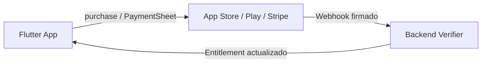

# Flutter Payments (IAP, RevenueCat & Stripe) Skill

> **Clasificación**: Skill Especializada (Flutter 3+ / Dart 3+) — Instalable en `.skill/flutter-payments-agent-skill/`.

## 📌 Propósito y Alcance

Estandariza monetización y pagos seguros en Flutter 3+: `in_app_purchase` (`purchaseStream` + `completePurchase`), RevenueCat (`purchases_flutter`), Stripe `PaymentSheet`, validación de recibos en servidor e idempotencia.

## ⚡ $-Comandos

| Comando | Acción | Descripción |
|---|---|---|
| `$pay` | Bootstrap | Activa reglas de pagos IAP, RevenueCat y Stripe en Flutter. |
| `$pay:audit` | Auditoría | Verifica validación server-side, `completePurchase()`, cero llaves secretas en cliente y restore purchases. |
| `$pay:webhooks` | Webhooks | Guía sincronización segura de entitlements vía backend. |

## 🧩 Arquitectura / Diagrama de Flujo



## ⚡ Quick Start

```bash
git submodule add git@github.com:Agent-Rules-Ecosystem/flutter-payments-agent-skill.git .skill/flutter-payments-agent-skill
```

Invoca `$pay` para activar la habilidad o `$pay:audit` para generar el reporte en `overview/work/skill/flutter-payments.md`.
