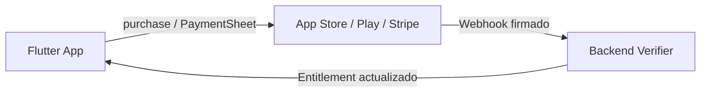

# Flutter Payments (IAP, RevenueCat & Stripe) Skill

## Matriz de Capacidades



## Protocolo de Auditoría (`$pay:audit`)

1. Buscar `sk_live_`, `sk_test_` o `whsec_` en `lib/` y assets.
2. Verificar que `purchaseStream` se escuche al inicio, se manejen estados `pending`/`error`/`restored` y se llame `completePurchase()`.
3. Confirmar presencia de flujo de `restorePurchases()` y verificación en servidor.
4. Persistir hallazgos en `overview/work/skill/flutter-payments.md`.

## Patrón Técnico Canónico

```dart
StreamSubscription<List<PurchaseDetails>> listenPurchases(InAppPurchase iap) {
  return iap.purchaseStream.listen((purchases) async {
    for (final purchase in purchases) {
      if (purchase.status == PurchaseStatus.purchased ||
          purchase.status == PurchaseStatus.restored) {
        final verified = await verifyReceiptOnServer(purchase);
        if (verified && purchase.pendingCompletePurchase) {
          await iap.completePurchase(purchase);
        }
      }
    }
  });
}
```

## 📝 Persistencia y Salida Activa

Guardar resultados de auditoría en `overview/work/skill/flutter-payments.md` con el esquema estándar:

| ID | Tipo | Estado | Resumen | Evidencia/Ruta | Acción Requerida |
|---|---|---|---|---|---|
| `s1` | `auditoria` | `activo` | Hallazgo concreto | `ruta/archivo#L10` | Corrección sugerida |
